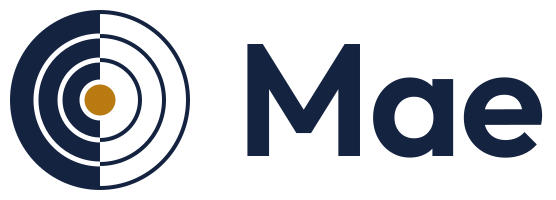

<h1><picture><source media="(prefers-color-scheme: dark)" srcset="docs/brand/mae-lockup-on-dark.svg"></picture></h1>

**Outpost** is a small, hackable multi-agent harness built on Claude: a place on your own machine where a crew gets your work done. This checkout is its first outpost, **Mae** (short for **M**y **A**lter **E**go). A **Quartermaster** plans your request, gets your OK on the plan, and sends specialists out on quests, several at once when the work allows. Each crew member has a fixed identity, its own memory and workspace, and clear limits on what it does.

| | Crew member | Does | Doesn't |
|---|---|---|---|
| 🧭 | **Quartermaster** | Plans, briefs the crew, reviews reports, schedules recurring jobs, answers general questions after a quick web search | Specialist work (dispatches it instead) |
| 🏹 | **Scout** | Research: web search and fetch, local files, cited findings | Polished writing, code |
| 🪶 | **Scribe** | Writing and editing docs, posts, emails, READMEs, PR descriptions | Code, new research |
| 🔨 | **Artificer** | Code: reads, edits, runs, and tests, with shell commands you approve | Prose, open-ended research |
| 🛡️ | **Warden** | Reviews pull requests and changes, raising only what would matter if it shipped | Nitpicks, fixing the code, posting anything you haven't approved |
| 🛸 | **Test Pilot** | The hardest missions: bugs nobody can reproduce, migrations with no clean path, problems nobody has mapped. Runs on the strongest model, gets one path working end to end first, and lists every shortcut it took | Routine changes and tests, reviewing, prose, open-ended research |

Ask a crew member for work outside its role and it declines in one line, naming the right teammate. You can add crew members of your own from the **+** on the crew bar.

**For a tour of what it does, open mission control and choose _Tour_ from the header's ··· menu** (it's [`docs/index.html`](docs/index.html)).

## Quick start

Requires Node 22.12 or later (CI runs on 24) and **npm**, and either a Claude subscription (Pro or Max) or an Anthropic API key. On a subscription the crew runs through [Claude Code](https://claude.com/claude-code), so that has to be installed too.

```bash
git clone https://github.com/rameden/the-outpost.git && cd the-outpost
npm install -g @anthropic-ai/claude-code   # once, if `claude` isn't already on your PATH (skip it if you'll use an API key)
npm install
claude auth login   # once: the crew runs through Claude Code on your subscription
npm start           # the star chart: pick an outpost (Mae, to begin with) and launch it; you land in mission control, signed in
```

On your subscription, usage counts against your plan's limits, and costs in the camp are estimates at API prices. Your own Claude Code settings, hooks, `CLAUDE.md` and MCP servers aren't loaded for the crew.

**On the API instead:** connect Anthropic in Settings → Models, then select the API runtime in Settings → General (or `/runtime api` in the terminal camp). Keys are verified before saving, kept in the owner-only `camp/providers.json`, and never returned to the page. A saved key takes precedence over `ANTHROPIC_API_KEY` in `.env`; disconnecting it falls back to the environment key. An existing environment key can be imported directly in Settings → Models without displaying it. API billing and limits are separate from your Claude subscription.

Other ways in:

```bash
npm run cli         # the camp in your terminal
npm run headless -- "…"   # one request, nobody at the keyboard (see below)
npm run watch:install   # (macOS) keep scheduled jobs running with nothing open
```

Try: *"Scout how other agent harnesses handle memory, then have the Scribe write it up as a short doc."*

**On Windows** it works the same way. The crew's commands run in Git Bash (or PowerShell without it; set `CAMP_SHELL` to choose), there's no sandbox (run inside WSL 2 for one), and `npm run watch:install` prints a Task Scheduler command instead of installing a macOS agent.

**On Linux** it hasn't been tested yet. Two things to know: the sandbox uses bubblewrap (install your distribution's `bubblewrap` package), and the terminal pane needs `node-pty`, which ships ready-built for macOS and Windows only, so on Linux it has to be compiled (`npm rebuild node-pty`, with a C++ toolchain and Python installed; `package.json`'s `allowScripts` turns its build script off by default). Everything but the terminal pane works without it.

**From your other machines at home (LAN mode):** by default only the machine the camp runs on can reach it. Put `CAMP_LAN=1` in `.env` and start it with `npm run ui:serve`: it prints the address your other machines use (for example `http://winbox:4747/`) and a sign-in link for it. It's plain HTTP, so it's for a home network you trust: never an office or shared network, and never a port forwarded to the internet. The terminal pane only opens on the camp's own machine (it's a shell there), and from another machine you paste a folder's path instead of using the folder dialog. Each browser signs in once with a one-time link: the camp's terminal prints one, or make one under Settings → Devices & uploads → Other devices. On Windows, allow Node through the firewall for private networks when it asks.

## Outposts

The app is Outpost, and each camp it runs is an outpost with a name of its own: one for work and one for home, say, that know nothing of each other. This checkout is the first outpost, Mae, with the `camp/` it has always had. The others live in `~/Outposts/<name>/` (set `OUTPOSTS_DIR` to put them elsewhere), each with its own crew, memory, settings, keys, jobs, skills and `.env`, and each runs as its own server on its own port.

`npm start` opens the star chart: every outpost on this machine, each a planet round the sun. Pick one to read about it, then launch it (or double-click it to start it, or enter it if it's already running); **New outpost** makes another. An outpost started from the chart links back to it from its header. Outposts started from the chart stop when you stop `npm start` (Ctrl-C). The same from the terminal:

```
npm run outpost                       # list them, and which are running
npm run outpost -- new Work           # make one, on the next free port (--port 4800 to choose)
npm run outpost -- start Work         # run it, serving the built page (like ui:serve)
npm run outpost -- start Work --dev   # run it with the page reloading as you edit (like npm run ui)
```

The header reads "Outpost" with the outpost's name under it. Rename an outpost from its Settings, General: the new name is kept in its `camp/outpost.json` and shows at once, while its folder stays where it is (`start` finds it by either name). A new outpost starts empty: connect its models and accounts from its own Settings. The crew's built-in skills are copied from this checkout and brought up to date each time an outpost starts, while skills an outpost learns stay in that outpost.

**From anywhere.** Two ways in, both on at once: the Lightsail relay (`scripts/relay/relay.sh`: your own small server with Caddy and Google sign-in at the door, reached through an SSH tunnel from this Mac) and Tailscale as the backup (`scripts/tailscale.sh`: tailnet only, no public address). Each keeps the camp running under launchd (so both are macOS only), and each script's header lists its steps. The relay script's defaults are the author's own setup: before you run it, set `RELAY_ZONE` to a domain you own (and `RELAY_DOMAIN`, `RELAY_NAME` and `RELAY_REGION` if you want other than `mae.<zone>`, `mae-relay` and `eu-west-1`); the `outpostmae.app` addresses below are examples of what you get. With no name they reach Mae, as they always have. Name an outpost after the command (or set `OUTPOST=Work`) to reach that one too:

```
scripts/relay/relay.sh create Work    # its DNS record (the server is shared)
scripts/relay/relay.sh server Work    # its tunnel key and an empty Caddy site
scripts/relay/relay.sh google Work    # Google sign-in, shared with Mae's (or: password Work)
scripts/relay/relay.sh install Work   # its camp and tunnel under launchd
scripts/relay/relay.sh link Work      # a sign-in link for a phone
scripts/tailscale.sh install Work     # and on the tailnet
```

On the relay each outpost gets a subdomain of its own (`work.outpostmae.app`), its own tunnel key and port on the server (its port + 1000), its own Caddy site in `/etc/caddy/sites/` and its own launchd jobs (`app.outpostmae.work.camp`, `…tunnel`), which run `npm run outpost -- start Work` from this checkout. A subdomain needs no change to the page or Caddy's routing, where a path per outpost would. Google sign-in is set up once, for Mae: the other outposts' doors send you through Mae's address to sign in, with the same allowed addresses, and one sign-in then covers them all. Each outpost still has its own key behind the door. On Tailscale a machine has one name, so each outpost but Mae is served on its own port there: `https://<this-mac>.<tailnet>.ts.net:4748/` for an outpost on 4748.

**The landing page.** `docs/index.html` (the Tour) is also the public page at `https://outpostmae.app`: a private S3 bucket behind CloudFront, with a free ACM certificate, and Route 53 pointing the domain and `www` (which redirects) at it. It's all one CloudFormation stack, `infra/site.yaml`, in us-east-1. `npm run site -- setup` makes it the first time (5–15 minutes), `npm run site -- deploy` puts up the current page after you change it, and `npm run site -- status` checks it from outside. It only touches the apex and `www` records, so the relay's `mae.outpostmae.app` and the outposts' subdomains stay as they are. For another domain, set `SITE_DOMAIN` (its hosted zone must be in the same account).

## Terminal commands

In `npm run cli`, type a request for the Quartermaster, or:

| Command | What it does |
|---|---|
| `@scout <task>` | Talk to one crew member directly (aliases work: `@writer`, `@dev`, `@research`) |
| `@path/to/file` | Attach a project file or folder anywhere in a message |
| `/link <path> [--edit]` · `/links` · `/unlink <name>` | Link a folder on your disk as `links/<name>/`, list links, remove one |
| `/reply <message>` | Follow up on the last expedition or chat |
| `/project [name \| off]` | List your projects, or work in one |
| `/worktree [<link> new [branch] \| <link> <path or branch> \| <link> off]` | Work in a new or existing worktree of a linked repo |
| `/good [note]` · `/bad [note]` | Rate the last answer |
| `/diff` · `/undo` | What the last expedition changed; put those files back |
| `/review` | Approve or reject skills the Quartermaster proposed |
| `/log` · `/jobs` · `/wiki` · `/memory <name>` | Recent quests; scheduled jobs; the wiki index; what a crew member remembers |
| `/model [name model [effort] \| name auto[:economy\|balanced\|quality] \| name reset]` · `/turns <name> <n \| reset>` | A crew member's model (or Auto), or how many turns one run may take |
| `/runtime [claude-code \| api]` · `/budget [dollars \| off]` | What runs the crew; a spending cap per expedition |
| Ctrl+C | Stop the running expedition; press again to quit |

## Mission control

Mission control opens on **Today** (the logo takes you back there, or `/today`): a greeting, where things stand in a few sentences, and the morning brief: what's waiting on you, your tickets, what's upcoming, your latest notes, and recent work, with the message box to start something new (in the project you last worked in).

Conversations are filed under projects in the sidebar, beside a live feed, approvals as buttons, a file pane and a terminal along the bottom. While a run works, Send becomes Stop, and Enter queues your next message behind it; a run you stop can be resumed later. Tool calls fold into one line per stretch ("Read 5 files, ran 2 commands"), and a Condensed/Detailed switch brings every line back. Attach a file, a folder, or a `.zip` (it arrives as the folder it holds), and mention `@scribe` anywhere in a plain chat to have the Scribe take that turn.

**Tickets.** With no Jira, Mae keeps tickets of its own (`MAE-1`, `MAE-2`…, in `camp/tickets.json`) on the **Tickets** page in the sidebar, which lists Jira's too once Jira is connected. Turn a note or a plan into tickets with one button, or let the Quartermaster make them. A ticket moves to In progress when work starts and to Done when its pull request merges. With **Ticket debrief** on (Settings → What Mae does unasked), a finished ticket, Mae's or Jira's, gets a look back: the smallest model reads the plan, each quest, what reviews and checks caught and what you had to ask for twice, and proposes lessons that are kept only once you approve them. After any expedition, a lesson can likewise be offered to the memory of whichever crew member did the work.

**Read aloud.** Connect an ElevenLabs key under Settings → Voice (or set `ELEVENLABS_API_KEY`) and Mae reads an answer, a job's report, an inbox item, a debrief or text you select in the voice you choose. One player in the top bar pauses, skips and changes speed, and each piece is kept, so hearing it again costs nothing.

**Housekeeping.** Ask the Quartermaster to clean up the camp: it lists what could go (unused uploads, finished worktrees, leftovers from a crash), then asks before each step and shows exactly what will be removed.

In mission control, ⌘P (Ctrl+P) opens the command palette, and a message starting with `/` is a command for the page (`/new`, `/find`, `/next`, `/settings`…). Two views take the whole page, both in the header's **Views** menu (which also holds the memory's constellation, `/constellation`; the Barnstorm game is at the foot of the ··· menu): **Orbit** (`/orbit`) shows the crew at work as a solar system, and the **trail map** (`/trail`) draws the Quartermaster's plan as a trail, one waypoint a step, with who was sent on it, how it stands, and a line from each step to the steps that wait for it (the Quartermaster marks those in the plan as "(after 1, 2)"; a plan that marks none is a straight trail), and its **Whole map** button puts every plan on one map, drawn either as rings (each plan a ring round one centre, the first asked innermost, and the runs of one conversation joined ring to ring) or as a tree that grows up from the foot of the window, each plan a bough off the trunk; **Tree** and **Rings** (or R) swap between the two. Both show the whole last day and can replay it, and live or replayed, each plan is drawn in as it joins. The Notes panel (`/notes`, or the tab on the right) is a place of your own to write things down: select text in a thread, or press Note under an answer, to keep it; a note goes into a message as text or as an attached file. The crew doesn't read your notes otherwise. Two things happen only when you ask: **Write up as a ticket** has the Scout read the project's code and turn a note into a ticket (a title, acceptance criteria, where it goes), kept beside the note with a **Start work** button; **Suggest ideas** asks what a project's record points at next, and what comes back sits in the list as suggestions until you keep or delete them.

## Headless runs

For scripts, CI, and GitHub Actions ([an example workflow](docs/github-action.md)):

```bash
npm run headless -- --json --approve-plan --worktree web "Fix the flaky date test in links/web"
echo "Tidy the README" | npm run headless -- --agent scribe -
```

- `--approve-plan` approves the plan; nothing else is approved for you. Shell commands run only if your allow-list or the sandbox lets them, and each decline is listed.
- `--json` prints one object at the end (`id`, `status`, `text`, `costUsd`, `changed`, `worktrees`, `declined`); progress goes to stderr.
- `--project <id>`, `--worktree <link>` and `--agent <name>` work as they do in mission control.
- Exit codes: 0 finished, 1 failed or refused, 2 stopped short (budget, turn limit, cut off).

## How it works

- **Two runtimes, one loop** (`src/agent.ts`). On your subscription each character runs as a Claude Code session (`src/claude-code.ts`), with the camp's tools served from an in-process MCP server so every boundary and approval still applies. On the API the camp runs the loop itself. Other providers (DeepSeek, Gemini, Groq, OpenRouter) can be connected under Settings → Models.
- **Auto model selection** (`src/routing.ts`, `src/autoroute.ts`). Pick **Auto** beside the message box, in a crew member's model picker, for a project's crew, or with `/model <name> auto` (Balanced unless you say `auto:economy` or `auto:quality`). Right before each dispatch, Auto profiles the task (kind, scope, what's at stake, images and tools needed, how big the request is), drops every model that can't take it (not connected, a confidential project's unapproved provider, too small a context, cooling down, over budget, or listed in `autoExclude` in `camp/settings.json`), and scores the rest on the odds of finishing (a model must clear the task's bar on its own), the expected cost including a possible rescue by another model, and time. It keeps the model through routine reads, edits and tests, and looks again when the task changes, a failing check shows the work is riskier than it looked, distinct fixes keep reproducing one failure, the request outgrows the model, or the provider is unavailable; a switch between healthy models has to be worth replaying the conversation. Each run says which model it used and why (in the feed and in Quests). Estimates start from labelled priors in a versioned policy and shift, within a limit, with graded outcomes (`camp/routing-evidence.json`): a run counts as a success only if its last check passed, and is weighed against what was expected on a task that hard; decisions and outcomes go to `camp/routing.jsonl` (no prompts, no keys), and `GET /api/routing` compares Auto with fixed models on matched tasks. A model you pick yourself stays pinned: if its provider fails, the run says so and suggests Auto. On your subscription Auto chooses at the start of a run; mid-run switching needs the API runtime. Settings → Models explains Auto and shows how its runs have gone; the camp's own small jobs (naming a conversation, tidying a memory) can use it too, where it means the cheapest small model that's connected and up to the job.
- **Nothing done twice** (`src/oplog.ts`). In a conversation, every command, file write and review a crew member makes is journaled before and after it runs (`camp/ops/`). When a run that didn't finish is picked up again, a call that already ran gets its recorded result back instead of running again, and one whose outcome was never recorded is checked (or held back with an explanation) before it can be retried.
- **Dispatch keeps context clean.** A crew member starts with no memory of the Quartermaster's conversation, works from a self-contained brief, and returns only a report.
- **Identity** lives in `src/crew.ts` and tools in `src/roster.ts`. Agents can grow their memory, but they can't rewrite who they are.
- **Colour themes** (`ui/src/themes.ts`; Settings → Appearance, or the Tour) are five sets of colours, **Camp**, **Harbor**, **Moss**, **Heather** and **Ochre**, each with a light side and a dark one, so switching light and dark (in the top bar, or following the system) never changes the set. A theme is kept in the browser and shared with the Tour.
- **Theme packs** (`src/packs.ts`; Settings → Appearance → Theme pack) rename the camp's own six, and everything the camp says follows the active pack: the page, the crew's prompts and tool descriptions, the server's notices, the terminal and the Tour use its five words and eight phrases (`src/words.ts`). **Guild** is the original; **Starship** makes them a Commander, Navigator, Comms Officer, Engineer, Security Chief and Test Pilot; **Newsroom** an Editor, Reporter, Columnist, Typesetter, Fact Checker and Stringer; **Studio** a Director, Location Scout, Screenwriter, Set Builder, Script Supervisor and Stunt Double; **Lab** a Lab Lead, Field Researcher, Author, Technician, Peer Reviewer and Tinkerer; **Pirate** a Commodore, Spyglass, Logkeeper, Rigger, First Mate and Powder Monkey. The names change for the crew too (their prompts use them), ids never change, and every pack's names keep working after `@`. Crew members you add keep the names you give them under every pack. The plane game (Barnstorm, in the header's ··· menu) dresses for the pack as well (`ui/src/egg/skins/`): on the Starship you fly a four-winged fighter against an empire's grey fleet, in the Newsroom you're a kid on a bike throwing papers with the whole street after you (the old man, the mail man, the mail cart), in the Studio a star throwing stars, in the Lab a mech dog with lasers for eyes, and under the Pirate flag a ship firing cannonballs; Guild and packs of your own keep the plane. You can make a pack of your own beside those six (Settings → Appearance → **New pack…**, or the pencil beside one you made): names and icons for the six, the five words and eight phrases (left out, they're made from the words), the line the crew reads about where they work, and the colours it suggests, starting from any pack if you like. Yours are kept in `camp/packs.json` and checked when the camp starts and when you save: a name, run-together name or short handle can't be one another crew member has, in that pack or any other, and a pack that doesn't pass is left out with the reason logged and shown in Settings, the rest of the file untouched. A pack of your own leaves the orb's colours as they are. Change or delete one and the names it gave still work after `@` and keep their colours in history; delete the one that's on and the camp goes back to Guild.
- **Decorations** (`ui/src/seasons.ts`; Settings → Appearance → Decorations) are holiday dressing and nothing else: **Winter** (snow), **Halloween** (a few bats) and **New Year** (confetti when an expedition finishes), each with a string of lights under the top bar and a tint on the orb. Off by default; pick one, or "Follow the calendar" to have each appear in its own days. They sit on top of any theme pack, colours and light or dark, are kept in this browser only, and change nothing the crew reads or writes. Nothing moves if your system asks for reduced motion.
- **Sounds** (`ui/src/chime.ts`) are kept in the browser too. With notifications on, a soft chime plays for a decision that's waiting, an expedition that finished and one that failed (Settings → Notifications → Notification sound, with a button to hear each).
- **Memory** has three layers: each agent's own `camp/agents/<id>/memory.md` and sessions; the shared wiki in `camp/wiki/` (`facts/` from you, `notes/` the crew found, with sources); and skills in `skills/<agent>/`, proposed by the Quartermaster and approved by you. `recall` searches what no longer fits in a prompt. In mission control, `/constellation` (or **Open the map** in Settings → Memory) draws every remembered line as a star, grouped by where it lives and joined to the lines it's like or used with: pick one to see where it came from and when it was used, and to pin, forget or merge it. A star grows each time its line is used, counted from `camp/recall-log.jsonl` (written from the day you update; nothing earlier is known).
- **Projects** decide what the crew sees: their folders (and those folders' `AGENTS.md` / `CLAUDE.md` / `.github/copilot-instructions.md`, loaded whole; a folder's guides for parts of it and its own skills under `.claude/skills`, `.agents/skills` or `.github/skills`, listed by name to read when they apply), a description, notes the crew keeps, and defaults. A conversation outside a project gets no linked folder unless you bring one in.
- **Scheduled jobs** run unattended and report to `camp/inbox.md`. An open outpost runs its own jobs, so there's nothing to set up. To keep them running with nothing open, `npm run watch:install` adds a background agent on macOS (`npm run watch:uninstall` removes it); on Linux or Windows, have cron or Task Scheduler call `npm run watch -- --once`. Only one process runs jobs at a time, so the two never double up.
- **What it does unasked** (while mission control is open). It follows the pull requests you opened in linked repositories, wherever their branches live (`src/pulls.ts`). A **pull-request trigger** (Settings → Scheduled jobs) carries new review comments or a failed check to the conversation that did the work, as a plan for you to approve, and can have the Scribe redraft the description after a push. A **morning brief** each weekday (`src/brief.ts`) says what's waiting on you, what's in motion, your tickets, what's upcoming and your latest notes, from the record and one look at GitHub and Jira: no model is called, and your notes stay on the page (they aren't sent to the inbox or your phone). A **weekly retro** (`src/retro.ts`) has the smallest model read the week's requests and what reviewers said, and propose what's worth keeping, for you to approve. When the same kind of work was asked for three times or more in the last four weeks, it also drafts a how-to for it, which waits under Settings → Skills. The **scoreboard** (`src/scoreboard.ts`, under Settings → Stats) counts how much of what you typed was operating the pipeline rather than deciding something. The switches for all of it are under Settings → What Mae does unasked.
  - The **night shift** (`src/nightshift.ts`) is off unless you switch it on. Between the hours you set (01:00 to 05:00 unless you change them), once nothing has been asked, running or queued for half an hour, it drafts shorter versions of up to three memories that are past 60% of what a prompt loads, lists unpinned lines more than 90 days old, and runs housekeeping's report. It only drafts and reports: nothing is applied, deleted or changed until you approve it. It makes at most three small model calls a night and none while your usage limit is used up. Each night is written to `camp/night/<day>.json`, and Today shows a "While you were away" card for what you haven't seen.

## Safety

- **Files:** file tools only work inside the camp folder and linked folders. They never read secrets (`.env*`, keys, credentials) at any depth, never touch another agent's memory, and can't write to `skills/`, `plugins/`, or `camp/` except an agent's own outputs folder. Symlinks are checked where they really lead.
- **The camp's own code is read-only** to agents (`src/`, `tests/`, `evals/`, `package.json`). Set `"selfEdit": true` in `camp/settings.json` to let the crew work on Outpost itself.
- **Shell commands ask first.** Only narrow read-only commands (`ls`, `git status`, `git diff`…) and your own allow-list run without asking. **Never run** and **Always ask** patterns under Settings → Approvals come before everything else. Commands stop after two minutes, and when you press Stop. The camp's keys and anything named like a secret are kept out of every command's environment.- **Sandbox** (macOS, or Linux with bubblewrap; off by default): commands run without asking, with no network except hosts you list, and writes only inside the project and temp folders. It doesn't protect the project folder itself, so use a worktree for work you want kept apart.
- **Nothing leaves without your click:** agents never commit, push, or merge. Opening a pull request is your button. The Warden's review comment and the Scribe's PR description go out only after you approve the exact text. The crew can read Jira but not write to it; if you turn write-back on, the camp itself leaves a fixed-wording comment on a ticket when its work starts, is ready to look over, gets a pull request, and is merged.
- **Untrusted content** (web pages, files, connector results, tickets, review comments) is treated as information, never as instructions.
- **Connectors** are read-only unless you allow writes, and then every write asks you first.
- **Budgets** cap each expedition across the Quartermaster and all its quests.
- **Mission control** listens only on `127.0.0.1`, checks the `Host` header, needs the camp's key for everything, and runs under a Content-Security-Policy with no inline code.

## Approvals from your phone

Optional, through [ntfy](https://ntfy.sh). Subscribe to a long random topic in the ntfy app and add it to `camp/settings.json`:

```json
"phone": { "topic": "camp-3f9c1e7a52d84b06", "approve": ["plan", "job"] }
```

You get a notification for each approval, job report, and long expedition that ends, with Approve and Decline for the kinds in `approve`. The approval's text goes to the ntfy server (set `"server"` to use your own), and anyone who knows the topic can press the buttons, so keep it long. Shell commands and connector writes only notify unless you add `"shell"` or `"tool"`.

## Configuration

Everything in `camp/` is local to you and gitignored. The main files:

| File | Holds |
|---|---|
| `camp/outpost.json` | The outpost's name and port |
| `camp/settings.json` | Models, budget, runtime, how much runs at once, shell rules, `selfEdit`, `phone`, terminal quick actions, `autoExclude` (models Auto never picks) |
| `camp/mcp.json` | MCP connectors (copy `mcp.example.json`) and which agents may use each |
| `camp/links.json` | Linked folders, their access, and their check commands |
| `camp/conversations.json` · `camp/projects/<id>/` | Projects and conversation filing; each project's survey, notes and chronicle |
| `camp/agents/<id>/` | Each agent's memory, sessions, and outputs |
| `camp/wiki/` · `camp/inbox.md` · `camp/quest-log.jsonl` | Shared knowledge, job reports, run history |
| `camp/feed.jsonl` | The saved feed, reloaded on restart |
| `camp/briefs/` · `camp/pulls.json` | Each day's brief; your pull requests in linked repositories, as last read |
| `camp/notes.json` | Your own notes (the Notes panel): off limits to the crew unless you put one in a message |
| `camp/tickets.json` · `camp/packs.json` · `camp/night/` | Mae's own tickets; theme packs you made; what each night shift left |
| `camp/jira.json` · `camp/providers.json` · `camp/.token` | Credentials and the camp's key: readable only by you, off limits to the crew |

Environment: `CAMP_PORT` for another port, `CAMP_NEW_TOKEN=1` for a new key, `CAMP_APPROVE_PLANS=0` to skip plan approval, `CAMP_RUNTIME` to pin the runtime, `CAMP_SHELL_ENV_ALLOW=GH_TOKEN,…` to pass a secret to commands on purpose, `CAMP_LAN=1` to reach the camp from your other machines at home (with `CAMP_NAMES` for extra names it answers to and `CAMP_HOST` to listen on one address), `CAMP_PROXY_NAMES` for the names a proxy in front of the camp serves it under (the Tailscale and relay scripts set it), `HUB_PORT` to move the star chart off 4700, `CAMP_UI_PORT` for the live-reload page's port under `npm run ui`, `CAMP_SHELL` to name the shell the crew's commands run in on Windows, `CLAUDE_CODE_EXECUTABLE` and `CAMP_GH` to point at a `claude` or `gh` that isn't on your PATH, and `ELEVENLABS_API_KEY` for read-aloud voices without saving a key in Settings → Voice. `npm run eval` reads `EVAL_SET`, `EVAL_CASE_BUDGET`, `EVAL_JUDGE_MODEL` and `EVAL_NO_JUDGE`.

## Development

The page is a React app in `ui/` (React 19, TypeScript, plain CSS, Vite).

```bash
npm start -- --dev  # the star chart, with each outpost's page reloading as you edit
npm run ui          # Mae alone, plus Vite: page edits reload live (restart it for edits under src/)
npm run ui:serve    # the camp alone, serving the built page
npm run prod        # production: typecheck, build the page and the server (dist/server.js), run it with plain node
npm run prod:start  # run the last prod build again, without rebuilding (a restart in ~0.3 s)
npm test            # the camp's tests, then the page's; no API key or Claude login needed
npm run typecheck   # source, tests, evals, scripts, the page, and the extension
npm run eval        # standard tasks against the real API (spends tokens)
npm run tour:films  # rebuild the Tour's films after the app changes
npm run extension:build   # Barnstorm, the plane game, as a Chrome extension (extension:pack zips it)
```

- The feed is a pure function of the camp's events (`ui/src/feed/reducer.ts`), so that's where to look first when the feed shows something wrong.
- The page's types come from the server's code (`ui/src/types.ts`), so `npm run typecheck` fails if the two disagree.
- Tests run each file in a throwaway camp against a fake streaming API. CI (`.github/workflows/ci.yml`) runs the types and the whole suite on every pull request.
- The built-in crew is defined in `src/crew.ts` and `src/roster.ts`, with skills in `skills/<id>/`. Crew members you add from the page live in `camp/crew.json`.
- The Barnstorm extension (`extension/`) puts the plane game over any web page; [`extension/README.md`](extension/README.md) covers loading it in Chrome and handing it to someone.
