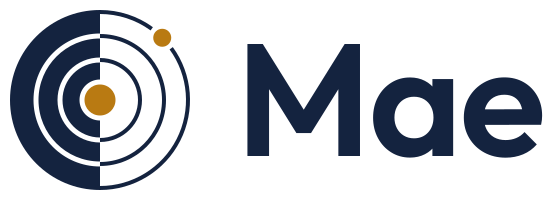
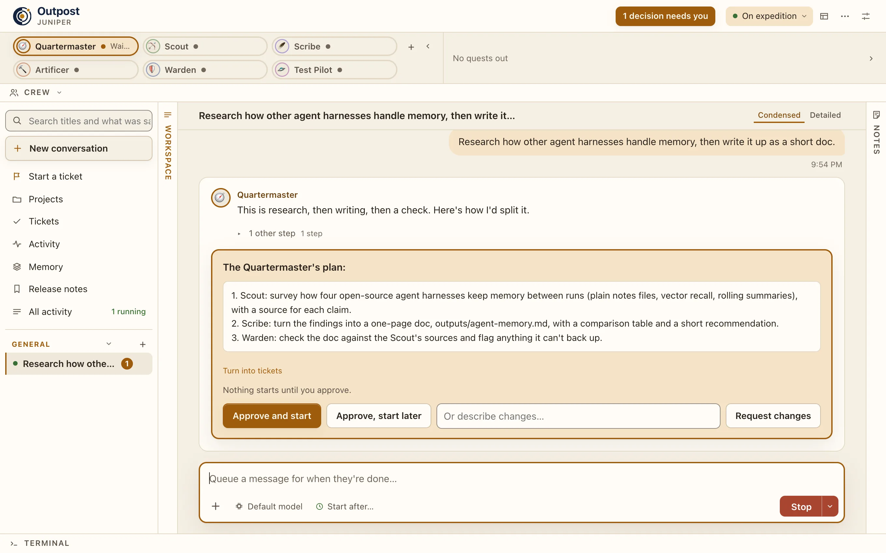

<h1><picture><source media="(prefers-color-scheme: dark)" srcset="docs/brand/outpost-lockup-on-dark.svg"></picture></h1>

**Outpost** is a small, hackable multi-agent harness built on Claude: a place on your own machine where a crew gets your work done. You ask for something, a **Quartermaster** plans it and gets your OK on the plan, then sends specialists out to do the parts, several at once when the work allows, and reviews what they bring back before you see it. Each crew member has a fixed role, its own memory and workspace, and clear limits on what it does.

It runs on your Claude subscription (through Claude Code) or an Anthropic API key, and you watch and steer it from a page in your browser.

<picture>
  <source media="(prefers-color-scheme: dark)" srcset="docs/shots/plan-dark.webp">
  
</picture>

*A demo outpost with made-up content: the plan waits for your OK before anything starts.*

**For the full tour**, see [outpostmae.app/about](https://outpostmae.app/about), or choose **About** from the ··· (More) menu in the page's header. It's [`docs/index.html`](docs/index.html). The landing page at [outpostmae.app](https://outpostmae.app) is [`docs/landing.html`](docs/landing.html), **Promo** in the same menu.

## Words you'll meet

**Outpost** (capital O) is the app. An **outpost** is one place it runs: a folder with its own crew, memory, settings, key and port, so one for work and one for home know nothing of each other. This checkout is the first outpost, **Mae** (short for **M**y **A**lter **E**go). The **crew** is the set of agents in an outpost: the Quartermaster, who plans and reviews, and the specialists it sends out (Scout, Scribe, Artificer, Warden and Test Pilot, to begin with). A **theme pack** renames the crew and the outpost's own words without changing what anything does: the default pack, Guild, calls a run an *expedition*, a step a *quest* and the page *mission control*, and Starship, Newsroom, Studio, Lab and Pirate each have their own.

## Install and first run

You need Node 22.12 or later with **npm**, and either a Claude subscription (Pro or Max) or an Anthropic API key. On a subscription the crew runs through [Claude Code](https://claude.com/claude-code), so that has to be installed too.

```bash
git clone https://github.com/rameden/the-outpost.git && cd the-outpost
npm install -g @anthropic-ai/claude-code   # once, if `claude` isn't already on your PATH (skip it if you'll use an API key)
npm install
claude auth login   # once: the crew runs through Claude Code on your subscription
npm start           # the star chart: pick an outpost (Mae, to begin with) and launch it; you land in its page, signed in
```

On your subscription, usage counts against your plan's limits, and the costs an outpost shows are estimates at API prices. To use an API key instead, or to run on Windows or Linux, see [Configuration](docs/configuration.md).

Other ways in:

```bash
npm run cli                   # an outpost in your terminal
npm run headless -- "…"       # one request, nobody at the keyboard
npm run outpost -- new Work   # a second outpost, apart from the first
```

## Your first ten minutes

1. **Launch Mae.** `npm start` opens the star chart in your browser. Pick Mae and press **Launch**: its page opens on **Today**.
2. **Ask for something that splits into parts.** In the message box, try: *"Scout how other agent harnesses handle memory, then have the Scribe write it up as a short doc."*
3. **Read the plan.** The Quartermaster answers with numbered steps and who does each. Nothing starts until you choose **Approve and start**, **Approve, start later** or **Request changes**.
4. **Watch it run.** Each crew member's work shows in the conversation as it happens. A shell command, or anything that would leave your machine, stops and asks you first.
5. **Read the report.** The Quartermaster sums up what was done and where the files are. [`examples/agent-harness-memory.md`](examples/agent-harness-memory.md) is what that request produced on one run.
6. **Point it at your own work.** Open **Projects** in the sidebar, make a project and add a folder to it. The crew can now read that folder, and conversations filed under the project work there.
7. **Set a limit.** Settings → Limits & budget has a budget per expedition, which covers the Quartermaster and everyone it sends out.
8. **Look around.** ⌘K (Ctrl+K) opens the command palette (⌘P still does; start with / for every command), and the header's Views menu has Orbit, a full-screen view of the crew at work.

## If something goes wrong

- **"Claude Code isn't installed."** Run `npm install -g @anthropic-ai/claude-code`, or set `CLAUDE_CODE_EXECUTABLE` to where your `claude` is.
- **It asks you to sign in to Claude.** Run `claude auth login` in a terminal, sign in with your Pro or Max account, and try again.
- **The port is taken.** The star chart uses 4700: start it with `HUB_PORT=4701 npm start` to move it. Mae uses 4747 unless its `camp/outpost.json` names another port (`CAMP_PORT` moves it when you start it by itself with `npm run ui`).
- **"This browser isn't signed in."** Sign-in links work once. Open the link the outpost printed in its terminal when it started, or press Enter in that terminal for a new one. Launching from the star chart signs you in for you.
- **`npm install` or `npm start` fails on an old Node.** Check `node --version`: it needs 22.12 or later.
- **You can't open it from your phone or another machine.** That's the default: an outpost listens only on the machine it runs on. [Remote access](docs/remote-access.md) has the ways to open it.
- **Something behaves differently on Windows or Linux.** [Configuration](docs/configuration.md#windows-and-linux) lists what's different on each.

## Read more

| | |
|---|---|
| [How Outpost works](docs/how-it-works.md) | The crew and what each one does, what the page shows, and the parts underneath: runtimes, model selection, memory, projects, scheduled jobs, what it does unasked |
| [Commands](docs/commands.md) | Terminal commands, the page's own commands, and headless runs for scripts and CI |
| [Safety](docs/safety.md) | What the crew can and can't touch, what asks first, and approvals from your phone |
| [Configuration](docs/configuration.md) | Subscription or API key, Windows and Linux, the files in `camp/`, and every environment variable ([`.env.example`](.env.example)) |
| [Outposts](docs/outposts.md) | The star chart, and making, starting and renaming outposts |
| [Remote access](docs/remote-access.md) | Reaching an outpost from your other machines at home, or from anywhere |
| [Development](docs/development.md) | Working on Outpost itself: the page, the tests, the evals, the extension |
| [GitHub Action](docs/github-action.md) | An example workflow for headless runs |

[The relay runbook](docs/remote-relay.md) is the author's own operations note for the relay and the public landing page. Outpost is under the [ISC licence](LICENSE).
