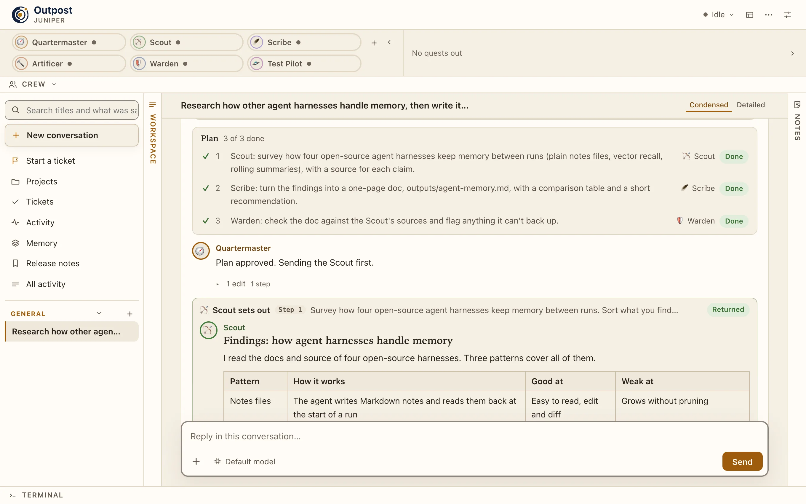
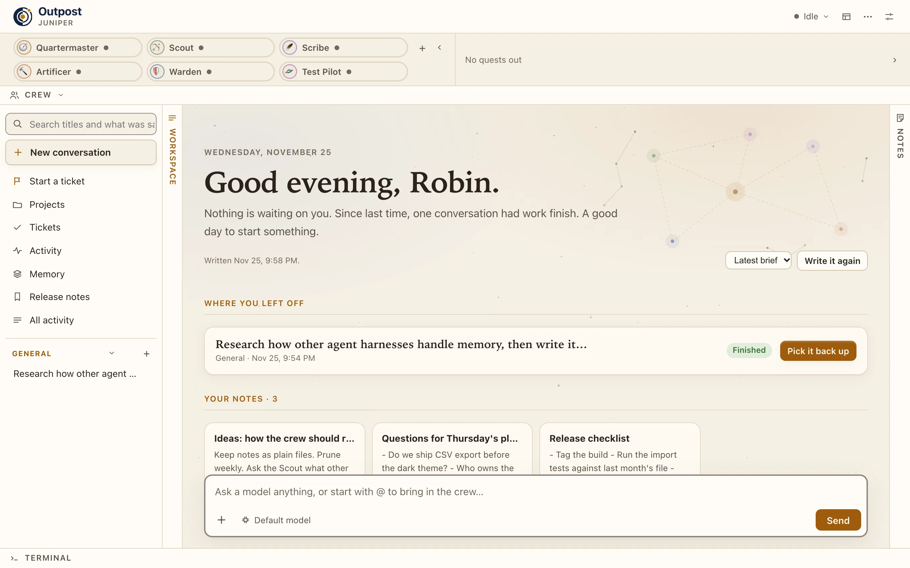
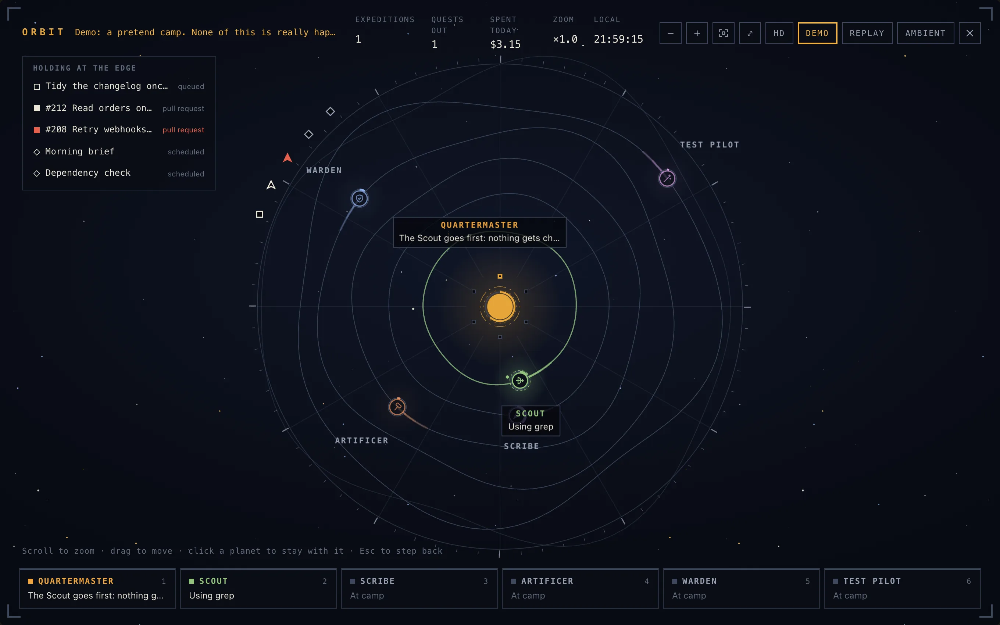

# How Outpost works

[← Back to the README](../README.md)

What the crew is, what the page shows, and how the parts fit together. The page is what the default Guild theme pack calls *mission control*; another pack gives it another name.

## The crew

| | Crew member | Does | Doesn't |
|---|---|---|---|
| 🧭 | **Quartermaster** | Plans, briefs the crew, reviews reports, schedules recurring jobs, answers general questions after a quick web search | Specialist work (dispatches it instead) |
| 🏹 | **Scout** | Research: web search and fetch, local files, cited findings | Polished writing, code |
| 🪶 | **Scribe** | Writing and editing docs, posts, emails, READMEs, PR descriptions | Code, new research |
| 🔨 | **Artificer** | Code: reads, edits, runs, and tests, with shell commands you approve | Prose, open-ended research |
| 🛡️ | **Warden** | Reviews pull requests and changes, raising only what would matter if it shipped | Nitpicks, fixing the code, posting anything you haven't approved |
| 🛸 | **Test Pilot** | The hardest missions: bugs nobody can reproduce, migrations with no clean path, problems nobody has mapped. Runs on the strongest model, gets one path working end to end first, and lists every shortcut it took | Routine changes and tests, reviewing, prose, open-ended research |

Ask a crew member for work outside its role and it declines in one line, naming the right teammate. You can add crew members of your own from the **+** on the crew bar.

<picture>
  <source media="(prefers-color-scheme: dark)" srcset="shots/run-dark.webp">
  
</picture>

*A finished plan in a demo outpost with made-up content: each step shows who did it and how it stands.*

## The page

The page opens on **Today** (the logo takes you back there, or `/today`): a greeting, where things stand in a few sentences, and the morning brief: what's waiting on you, your tickets, what's upcoming, your latest notes, and recent work, with the message box to start something new (in the project you last worked in).

<picture>
  <source media="(prefers-color-scheme: dark)" srcset="shots/today-dark.webp">
  
</picture>

*Today, in a demo outpost with made-up content.*

Conversations are filed under projects in the sidebar, beside a live feed, approvals as buttons, a file pane and a terminal along the bottom. While a run works, Send becomes Stop, and Enter queues your next message behind it; a run you stop can be resumed later. Tool calls fold into one line per stretch ("Read 5 files, ran 2 commands"), and a Condensed/Detailed switch brings every line back. Attach a file, a folder, or a `.zip` (it arrives as the folder it holds), and mention `@scribe` anywhere in a plain chat to have the Scribe take that turn.

**Tickets.** With no Jira, an outpost keeps tickets of its own (`MAE-1`, `MAE-2`…, in `camp/tickets.json`) on the **Tickets** page in the sidebar, which lists Jira's too once Jira is connected. Turn a note or a plan into tickets with one button, or let the Quartermaster make them. A ticket moves to In progress when work starts and to Done when its pull request merges. With **Ticket debrief** on (one of the switches for what the outpost does unasked: today under Activity → Unasked), a finished ticket, its own or Jira's, gets a look back: the smallest model reads the plan, each quest, what reviews and checks caught and what you had to ask for twice, and proposes lessons that are kept only once you approve them. After any expedition, a lesson can likewise be offered to the memory of whichever crew member did the work.

**Read aloud.** Connect an ElevenLabs key under Settings → Voice (or set `ELEVENLABS_API_KEY`) and the outpost reads an answer, a job's report, an inbox item, a debrief or text you select in the voice you choose. One player in the top bar pauses, skips and changes speed, and each piece is kept, so hearing it again costs nothing.

**Housekeeping.** Ask the Quartermaster to clean up the outpost: it lists what could go (unused uploads, finished worktrees, leftovers from a crash), then asks before each step and shows exactly what will be removed.

In the page, ⌘P (Ctrl+P) opens the command palette, and a message starting with `/` is a command for the page (`/new`, `/find`, `/next`, `/settings`…). Two views take the whole page (the memory's constellation is the Map view of the Memory page, with a **Full screen** of its own, and the header's **Views** menu or `/constellation` opens it that way; the Barnstorm game is at the foot of the ··· (More) menu): **Orbit** (`/orbit`, or the header's **Views** menu) shows the crew at work as a solar system, and the **trail map** (`/trail`, the **Views** menu, or **Full screen** on a plan's card, which can also draw the plan as a trail in place) draws the Quartermaster's plan as a trail, one waypoint a step, with who was sent on it, how it stands, and a line from each step to the steps that wait for it (the Quartermaster marks those in the plan as "(after 1, 2)"; a plan that marks none is a straight trail), and its **Whole map** button puts every plan on one map, drawn either as rings (each plan a ring round one centre, the first asked innermost, and the runs of one conversation joined ring to ring) or as a tree that grows up from the foot of the window, each plan a bough off the trunk; **Tree** and **Rings** (or R) swap between the two. Both show the whole last day and can replay it, and live or replayed, each plan is drawn in as it joins. The Notes panel (`/notes`, or the tab on the right) is a place of your own to write things down: select text in a thread, or press Note under an answer, to keep it; a note goes into a message as text or as an attached file. The crew doesn't read your notes otherwise. Two things happen only when you ask: **Write up as a ticket** has the Scout read the project's code and turn a note into a ticket (a title, acceptance criteria, where it goes), kept beside the note with a **Start work** button; **Suggest ideas** asks what a project's record points at next, and what comes back sits in the list as suggestions until you keep or delete them.

*Orbit in its Demo mode, which plays a pretend outpost: nothing here is real work.*

**Also there.** **Release notes** (in the sidebar) sums up what's changed in Outpost itself: every 48 hours while the outpost is open, from the pull requests merged into its repository, front end and back end apart, newest first. **Is it paying off?** (on a project's page) counts the last 30 days: what reviews, second opinions and failed checks turned up, what they used, and how the project's pull requests went, so you can switch off what isn't earning its keep.

## Under the hood

- **Two runtimes, one loop** (`src/agent.ts`). On your subscription each character runs as a Claude Code session (`src/claude-code.ts`), with the outpost's tools served from an in-process MCP server so every boundary and approval still applies. On the API the outpost runs the loop itself. Other providers (DeepSeek, Gemini, Groq, OpenAI, OpenRouter) can be connected under Settings → Models; their models run through the same loop as the API's. OpenAI's GPT models take an OpenAI API key, billed by OpenAI apart from any ChatGPT plan, and their costs are counted at OpenAI's listed prices.
- **Auto model selection** (`src/routing.ts`, `src/autoroute.ts`). Pick **Auto** beside the message box, in a crew member's model picker, for a project's crew, or with `/model <name> auto` (Balanced unless you say `auto:economy` or `auto:quality`). Right before each dispatch, Auto profiles the task (kind, scope, what's at stake, images and tools needed, how big the request is), drops every model that can't take it (not connected, a confidential project's unapproved provider, too small a context, cooling down, over budget, or listed in `autoExclude` in `camp/settings.json`), and scores the rest on the odds of finishing (a model must clear the task's bar on its own), the expected cost including a possible rescue by another model, and time. On a close call it leans to Claude (`preferClaude` in the policy): another provider's model is chosen only when it's clearly cheaper or likelier to finish, and the run's reason says when the lean decided it. It keeps the model through routine reads, edits and tests, and looks again when the task changes, a failing check shows the work is riskier than it looked, distinct fixes keep reproducing one failure, the request outgrows the model, or the provider is unavailable; a switch between healthy models has to be worth replaying the conversation. Each run says which model it used and why (in the feed and in Quests). Estimates start from labelled priors in a versioned policy and shift, within a limit, with graded outcomes (`camp/routing-evidence.json`): a run counts as a success only if its last check passed, and is weighed against what was expected on a task that hard; decisions and outcomes go to `camp/routing.jsonl` (no prompts, no keys), and `GET /api/routing` compares Auto with fixed models on matched tasks. A model you pick yourself stays pinned: if its provider fails, the run says so and suggests Auto. On your subscription Auto chooses at the start of a run; mid-run switching needs the API runtime. Settings → Models explains Auto and shows how its runs have gone; the outpost's own small jobs (naming a conversation, tidying a memory) can use it too, where it means the cheapest small model that's connected and up to the job.
- **Nothing done twice** (`src/oplog.ts`). In a conversation, every command, file write and review a crew member makes is journaled before and after it runs (`camp/ops/`). When a run that didn't finish is picked up again, a call that already ran gets its recorded result back instead of running again, and one whose outcome was never recorded is checked (or held back with an explanation) before it can be retried.
- **Dispatch keeps context clean.** A crew member starts with no memory of the Quartermaster's conversation, works from a self-contained brief, and returns only a report.
- **Identity** lives in `src/crew.ts` and tools in `src/roster.ts`. Agents can grow their memory, but they can't rewrite who they are.
- **Colour themes** (`ui/src/themes.ts`; Settings → Appearance, or the Tour) are five sets of colours, **Camp**, **Harbor**, **Moss**, **Heather** and **Ochre**, each with a light side and a dark one, so switching light and dark (in the top bar, or following the system) never changes the set. A theme is kept in the browser and shared with the Tour.
- **Theme packs** (`src/packs.ts`; Settings → Appearance → Theme pack) rename the outpost's own six, and everything the outpost says follows the active pack: the page, the crew's prompts and tool descriptions, the server's notices, the terminal and the Tour use its five words and eight phrases (`src/words.ts`). **Guild** is the original; **Starship** makes them a Commander, Navigator, Comms Officer, Engineer, Security Chief and Test Pilot; **Newsroom** an Editor, Reporter, Columnist, Typesetter, Fact Checker and Stringer; **Studio** a Director, Location Scout, Screenwriter, Set Builder, Script Supervisor and Stunt Double; **Lab** a Lab Lead, Field Researcher, Author, Technician, Peer Reviewer and Tinkerer; **Pirate** a Commodore, Spyglass, Logkeeper, Rigger, First Mate and Powder Monkey. The names change for the crew too (their prompts use them), ids never change, and every pack's names keep working after `@`. Crew members you add keep the names you give them under every pack. The plane game (Barnstorm, in the header's ··· (More) menu) dresses for the pack as well (`ui/src/egg/skins/`): on the Starship you fly a four-winged fighter against an empire's grey fleet, in the Newsroom you're a kid on a bike throwing papers with the whole street after you (the old man, the mail man, the mail cart), in the Studio a star throwing stars, in the Lab a mech dog with lasers for eyes, and under the Pirate flag a ship firing cannonballs; Guild and packs of your own keep the plane. You can make a pack of your own beside those six (Settings → Appearance → **New pack…**, or the pencil beside one you made): names and icons for the six, the five words and eight phrases (left out, they're made from the words), the line the crew reads about where they work, and the colours it suggests, starting from any pack if you like. Yours are kept in `camp/packs.json` and checked when the outpost starts and when you save: a name, run-together name or short handle can't be one another crew member has, in that pack or any other, and a pack that doesn't pass is left out with the reason logged and shown in Settings, the rest of the file untouched. A pack of your own leaves the orb's colours as they are. Change or delete one and the names it gave still work after `@` and keep their colours in history; delete the one that's on and the outpost goes back to Guild.
- **Decorations** (`ui/src/seasons.ts`; Settings → Appearance → Decorations) are holiday dressing and nothing else: **Winter** (snow), **Halloween** (a few bats) and **New Year** (confetti when an expedition finishes), each with a string of lights under the top bar and a tint on the orb. Off by default; pick one, or "Follow the calendar" to have each appear in its own days. They sit on top of any theme pack, colours and light or dark, are kept in this browser only, and change nothing the crew reads or writes. Nothing moves if your system asks for reduced motion.
- **Sounds** (`ui/src/chime.ts`) are kept in the browser too. With notifications on, a soft chime plays for a decision that's waiting, an expedition that finished and one that failed (Settings → Notifications → Notification sound, with a button to hear each).
- **Memory** has three layers: each agent's own `camp/agents/<id>/memory.md` and sessions; the shared wiki in `camp/wiki/` (`facts/` from you, `notes/` the crew found, with sources); and skills in `skills/<agent>/`, proposed by the Quartermaster and approved by you. `recall` searches what no longer fits in a prompt. In the page, `/constellation` (or **Open the map** on the Memory page, under Map) draws every remembered line as a star, grouped by where it lives and joined to the lines it's like or used with: pick one to see where it came from and when it was used, and to pin, forget or merge it. A star grows each time its line is used, counted from `camp/recall-log.jsonl` (written from the day you update; nothing earlier is known).
- **Projects** decide what the crew sees: their folders (and those folders' `AGENTS.md` / `CLAUDE.md` / `.github/copilot-instructions.md`, loaded whole; a folder's guides for parts of it and its own skills under `.claude/skills`, `.agents/skills` or `.github/skills`, listed by name to read when they apply), a description, notes the crew keeps, and defaults. A conversation outside a project gets no linked folder unless you bring one in.
- **Scheduled jobs** run unattended and report to `camp/inbox.md`. An open outpost runs its own jobs, so there's nothing to set up. To keep them running with nothing open, `npm run watch:install` adds a background agent on macOS (`npm run watch:uninstall` removes it); on Linux or Windows, have cron or Task Scheduler call `npm run watch -- --once`. Only one process runs jobs at a time, so the two never double up.
- **What it does unasked** (while the outpost's page is open). It follows the pull requests you opened in linked repositories, wherever their branches live (`src/pulls.ts`). A **pull-request trigger** (Activity → Scheduled jobs) carries new review comments or a failed check to the conversation that did the work, as a plan for you to approve, and can have the Scribe redraft the description after a push. A **morning brief** each weekday (`src/brief.ts`) says what's waiting on you, what's in motion, your tickets, what's upcoming and your latest notes, from the record and one look at GitHub and Jira: no model is called, and your notes stay on the page (they aren't sent to the inbox or your phone). A **weekly retro** (`src/reports.ts`) has the smallest model read the week's requests and what reviewers said, and propose what's worth keeping, for you to approve. When the same kind of work was asked for three times or more in the last four weeks, it also drafts a how-to for it, which waits under Settings → Skills. The **scoreboard** (`src/reports.ts`, under Activity → Stats) counts how much of what you typed was operating the pipeline rather than deciding something. Each has a switch of its own (today under Activity → Unasked).
  - The **night shift** (`src/nightshift.ts`) is off unless you switch it on. Between the hours you set (01:00 to 05:00 unless you change them), once nothing has been asked, running or queued for half an hour, it drafts shorter versions of up to three memories that are past 60% of what a prompt loads, lists unpinned lines more than 90 days old, and runs housekeeping's report. It only drafts and reports: nothing is applied, deleted or changed until you approve it. It makes at most three small model calls a night and none while your usage limit is used up. Each night is written to `camp/night/<day>.json`, and Today shows a "While you were away" card for what you haven't seen.

