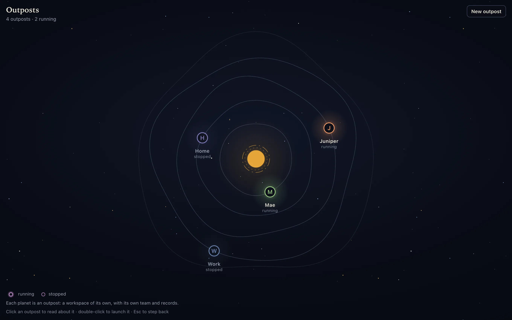

# Outposts

[← Back to the README](../README.md)

The app is Outpost, and each place it runs is an outpost with a name of its own: one for work and one for home, say, that know nothing of each other. This checkout is the first outpost, Mae, with the `camp/` it has always had. The others live in `~/Outposts/<name>/` (set `OUTPOSTS_DIR` to put them elsewhere), each with its own crew, memory, settings, keys, jobs, skills and `.env`, and each runs as its own server on its own port.

`npm start` opens the star chart: every outpost on this machine, each a planet round the sun. Pick one to read about it, then launch it (or double-click it to start it, or enter it if it's already running); **New outpost** makes another. An outpost started from the chart links back to it from its header. Outposts started from the chart stop when you stop `npm start` (Ctrl-C). The same from the terminal:



*The star chart with three demo outposts beside Mae.*

```
npm run outpost                       # list them, and which are running
npm run outpost -- new Work           # make one, on the next free port (--port 4800 to choose)
npm run outpost -- start Work         # run it, serving the built page (like ui:serve)
npm run outpost -- start Work --dev   # run it with the page reloading as you edit (like npm run ui)
```

The header reads "Outpost" with the outpost's name under it. Rename an outpost from its Settings, General: the new name is kept in its `camp/outpost.json` and shows at once, while its folder stays where it is (`start` finds it by either name). A new outpost starts empty: connect its models and accounts from its own Settings. The crew's built-in skills are copied from this checkout and brought up to date each time an outpost starts, while skills an outpost learns stay in that outpost.

To reach an outpost from another machine or from your phone, see [Remote access](remote-access.md).
